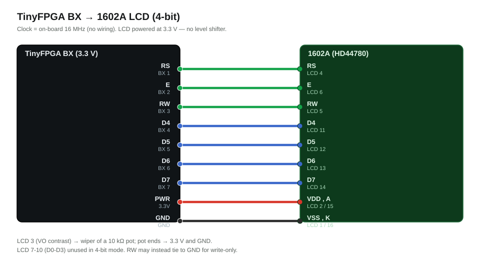
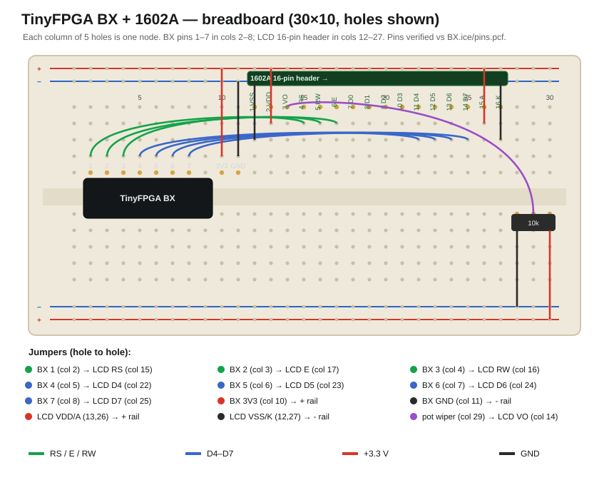

# TinyFPGA BX labs

Synthesizable lab designs for the **TinyFPGA BX** (Lattice iCE40 LP8K). The first
example drives a **Hitachi HD44780 / 1602A character LCD** in 4‑bit mode and
prints `Hello World!`, built visually in **Icestudio**.

> A **Paradox Transistor Lab** project.

## The board — TinyFPGA BX

| | |
|---|---|
| FPGA | Lattice **iCE40LP8K‑CM81** (~7 680 logic cells, 128 Kbit block RAM) |
| I/O | ~24 user GPIO, **3.3 V** logic |
| Clock | **16 MHz** on‑board oscillator (plus the iCE40 internal 48 MHz HFOSC / PLL) |
| Program | USB bootloader → **`tinyprog`** (no external programmer) |
| Toolchain | open source: **Icestudio** or **APIO** → yosys + nextpnr/arachne + icestorm |
| Analog | **none** — the iCE40 is a purely digital FPGA (no ADC, no analog inputs) |

## This repo

```
BX_Bottom/BX.ice   Icestudio project: the HD44780 "Hello World!" LCD example
```

Open `BX_Bottom/BX.ice` in [Icestudio](https://icestudio.io/). It's seven
output pins plus one Verilog **code block** that sequences the LCD.

### The HD44780 example

A free‑running counter steps through a small ROM of 4‑bit nibbles: the HD44780
init sequence (function set → display on → clear → entry mode) followed by the
characters of `Hello World!`, strobing **E** for each nibble. Write‑only, 4‑bit
bus.



**Breadboard layout:**



**Pin map (TinyFPGA BX → 1602A):**

| BX pin | LCD | |
|---|---|---|
| 1 | **RS** | register select |
| 2 | **E** | enable strobe |
| 3 | **RW** | read/write |
| 4 | **D4** | data (4‑bit bus) |
| 5 | **D5** | |
| 6 | **D6** | |
| 7 | **D7** | |
| 3.3 V | VDD, A (backlight +) | — |
| GND | VSS, K, RW‑tie if write‑only | — |
| 10 kΩ pot | VO | contrast |

> **Power the 1602A at 3.3 V** so its logic matches the BX's 3.3 V outputs (no
> level shifter). If the contrast/backlight is weak on your module, drive VDD at
> 5 V and add a 3.3→5 V level shifter on RS/E/D4‑D7, or use a 5 V MCU instead.

### Build & program

- **Icestudio:** open the project, **Build**, then **Upload** (it calls APIO /
  icestorm and `tinyprog` for you).
- **APIO (CLI):** `apio build` then `apio upload`.
- Programming always goes over USB through the BX bootloader (`tinyprog`).

---

## Can we build a battery‑level gauge + display on this board?

**Short answer: yes for the display, but the FPGA needs help to *measure* the
battery** — because the iCE40 has **no ADC**. The LCD half is already proven by
the example here; the missing piece is turning the cell's analog voltage into
digital.

### What's already solved
- Driving the **1602A** from the BX (this example).
- Reading **TP4056** `CHRG` / `STDBY` status — those are digital open‑drain
  outputs; wire them to two BX inputs (with pull‑ups) for "charging / full".

### The gap: no analog input
Unlike a Raspberry Pi Pico or ESP32 (which have built‑in ADCs), the TinyFPGA BX
can't read the battery voltage directly. You add the conversion externally — three
options, simplest first:

1. **External SPI ADC** (e.g. **MCP3002 / MCP3201 / MCP3008**). Battery → a
   100 kΩ/100 kΩ divider → ADC input; the BX runs a small **SPI master** (~4
   pins) to read it, maps volts → %, and writes the LCD. *Recommended — clean,
   few parts, accurate.*
2. **Sigma‑delta ADC with one comparator** + an RC feedback DAC (a PWM pin +
   resistor/cap) — the classic "ADC with no ADC chip" FPGA trick. Minimal parts,
   but more RTL and calibration.
3. **Comparator → flash ADC:** a resistor ladder + comparators (or an LM3914‑style
   front end) give the BX a thermometer code of the voltage on several inputs.
   Simple logic, more board parts.

### What the firmware would add
The example prints a **fixed** string. A gauge needs **dynamic** text — read the
ADC, convert the number to ASCII digits (binary→BCD) and a bar, and stream them
to the LCD. That logic is much easier in **hand‑written Verilog** (APIO) than in
the Icestudio block view, so the gauge would likely graduate this lab from
Icestudio to a Verilog project.

### Verdict
**Feasible.** Pin/resource budget is tiny (LCD 6 + SPI ADC 4 + status 2 ≈ 12 of
~24 I/O). The only addition over a microcontroller build is **one ADC chip**,
which is the price of using an FPGA with no analog front end. The MCP3002 + the
existing LCD driver is the most direct path.

---

*Part of the **Paradox Transistor Lab** FPGA labs by
[@Galaviz1](https://github.com/Galaviz1).*
